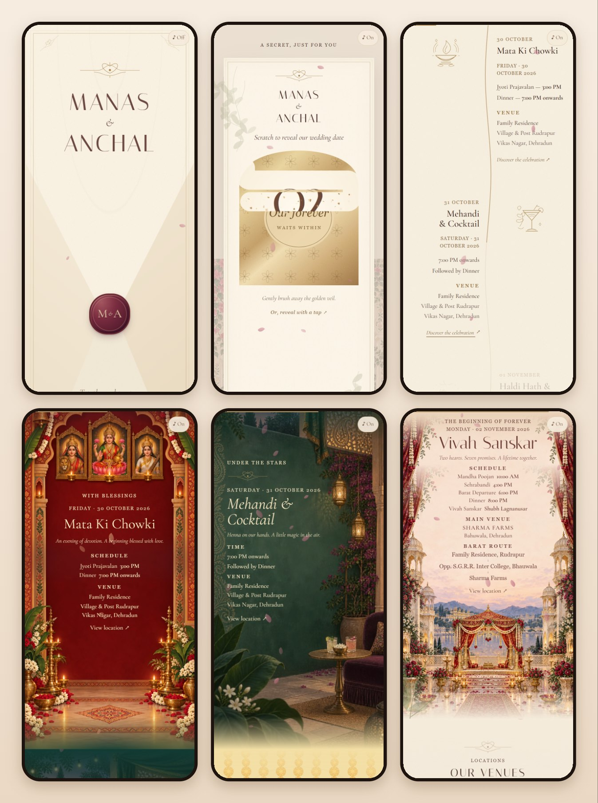

<div align="center">

# Manas & Anchal — A Wedding Story

**An interactive, illustrated wedding invitation, made for phones.**

### [Open the invitation →](https://invitations-xi.vercel.app)

30 October – 2 November 2026 · Dehradun

<br>



</div>

<br>

## The experience

1. **A sealed letter.** Tap the wax seal and the envelope opens, the invitation rising out of it.
2. **A secret date.** Scratch away a gold-foil panel to uncover the wedding date, with flakes of foil falling under your finger. Or reveal it with a single tap.
3. **A live countdown** to the wedding day, kept in India time wherever guests open it.
4. **The celebrations.** A gold thread draws through the four days as you scroll, from Mata Ki Chowki to Vivah Sanskar.
5. **Four illustrated chapters**, one per ceremony, each with its schedule, venue and a map link.
6. **The venues and the families.** Interactive maps for both venues, then a closing note from both families.

Music begins softly when the seal is tapped, with a mute button always within reach.

## Made with care

- **Phone first.** Designed for one-handed scrolling and checked at phone widths from 360 to 430 px.
- **Smooth on modest phones.** Each part plays its entrance once as it arrives, on the graphics hardware; nothing is recalculated on every scrolled frame, and sections keep their size when mobile browser toolbars hide or show.
- **Gentle on everyone.** With the system's "reduce motion" setting on, everything appears at once and decorative motion stops. A tap reveals the date for anyone who'd rather not scratch, and the date is still there if JavaScript doesn't load.
- **Private.** No forms, no sign-ups. Visits are counted with Vercel Web Analytics, which doesn't use cookies.

## Built with

React 19 · TypeScript · Vite · Tailwind CSS 4 · Framer Motion · Canvas 2D · Vercel

```text
src/
  data/weddingData.ts        every wedding detail: dates, schedules, venues, families
  components/scenes/         one component per chapter of the story
  components/interactive/    the scratch card and the countdown
  components/ui/             petals, music control, ornaments, reveal helpers
  styles/globals.css         the look of every chapter
public/                      illustrations and music
```

## For the maintainer

```sh
npm install
npm run dev      # local preview
npm test         # countdown time-zone checks
npm run build    # production build
```

Every push to `main` is deployed to the live invitation by Vercel.

## Rights

© 2026 Ayush Bhatt. All rights reserved. This repository is public so the project can be seen, not reused: see [LICENSE](LICENSE).
